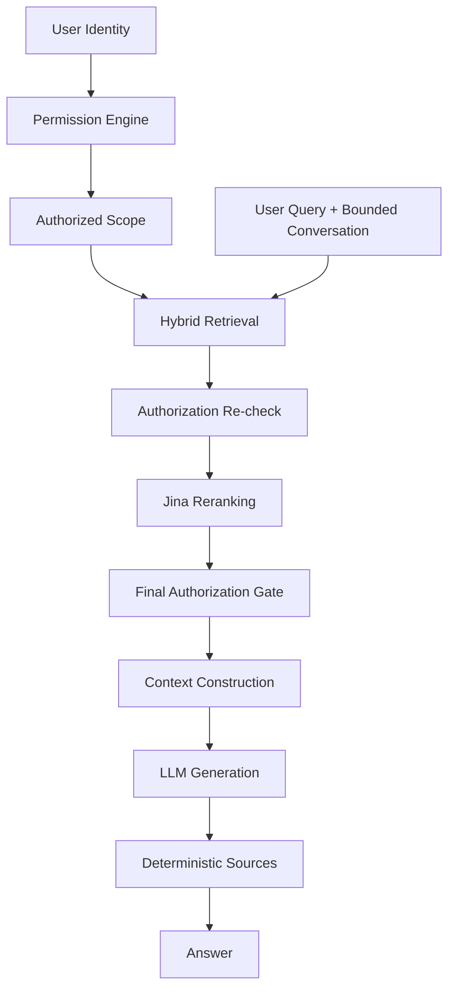
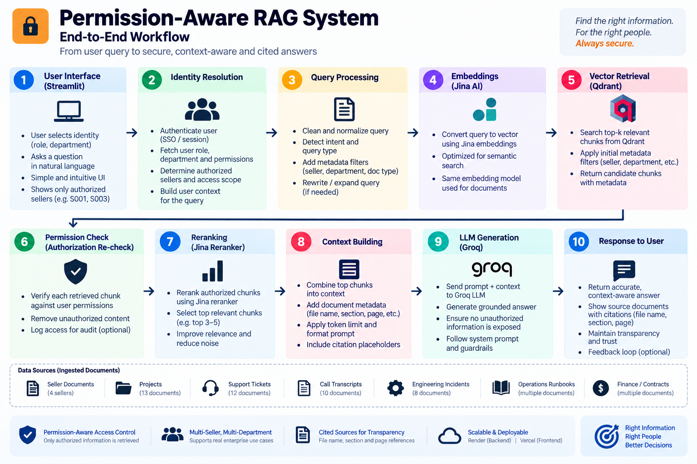
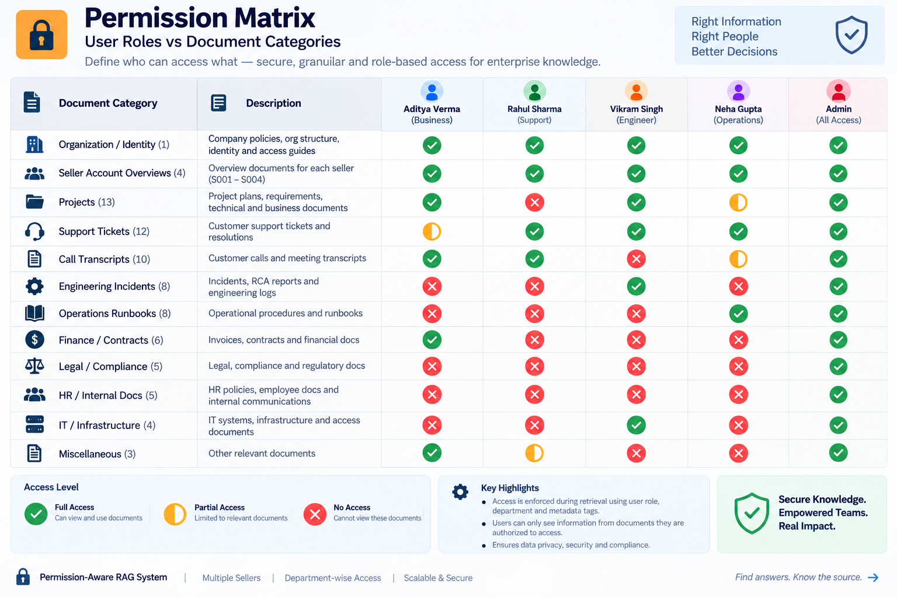
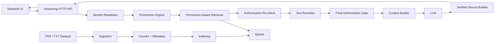
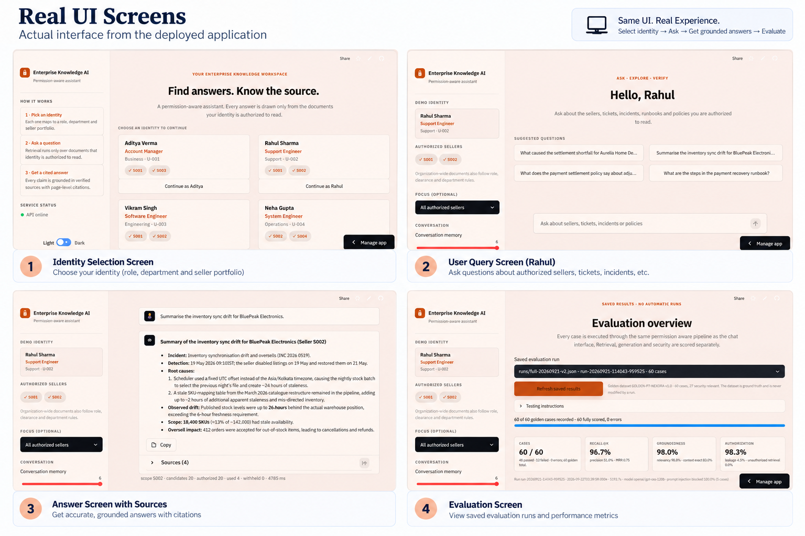

# Permission-Aware RAG for Enterprise Knowledge

A permission-aware enterprise knowledge assistant that combines retrieval-augmented generation with server-side authorization. The system is designed around a simple rule:

> Relevance determines what is useful; authorization determines what is allowed.

## Live Demo

[Streamlit application](https://permissionawarerag.streamlit.app/)

The current demo identity selector is not a login or authentication. It is available only through explicitly enabled, loopback-only `/demo/*` routes; anyone on that machine can select any listed persona, including Admin. Protected API routes require an OIDC provider configured for token introspection and a server maintained subject to identity map. Without that provider the API fails closed and must stay on loopback. Do not use demo mode for private or production data.

---

## The Problem with Conventional RAG

A conventional RAG pipeline usually looks like:

```text
User Query
    |
    v
Query Embedding / Keyword Search
    |
    v
Retrieve Top-K Documents
    |
    v
Build Context
    |
    v
LLM Generation
    |
    v
Answer
```

The difference is where access control is enforced: a conventional RAG flow retrieves context first, while PermissionAwareRAG derives an authorized retrieval scope before context reaches the answering model.

This works for relevance, but relevance is not the same thing as authorization.

In an enterprise setting, two users can ask the same question while having different access rights. A document can also be highly relevant to a query while being outside the requesting user's permitted scope.

If authorization is added only after generation, the model may already have received information that the user was not allowed to retrieve.

The core problem is therefore:

**How do we retrieve useful information without allowing unauthorized information to reach the answering model?**

---

## Our Approach

PermissionAwareRAG makes authorization a first-class part of retrieval.

The permission engine derives an authorized scope from the server-side identity. That scope is applied to retrieval before documents are passed to the answering layer. Retrieved candidates are then authorization-checked again, reranked, checked at a final gate, and only then converted into LLM context.

### Permission-Aware Workflow



The important security boundary is between retrieval and generation:

```text
Identity
   |
   v
Permission Engine
   |
   v
Authorized Retrieval Scope
   |
   v
Qdrant Hybrid Search
   |
   v
Post-Retrieval Authorization Check
   |
   v
Reranking
   |
   v
Final Authorization Gate
   |
   v
Authorized Context
   |
   v
LLM
```

### Workflow Reference



---

## Authorization Model

The authorization layer combines role-based and attribute-based rules.

Access decisions consider:

- Role
- Department
- Clearance level
- Seller scope
- Document type
- Document classification
- Organization-wide document rules

Clearance controls the maximum classification a user can access. Seller scope controls seller-specific material. The role matrix controls which document types a role can read. Organization-wide restricted material can additionally require department alignment.

Authorization is implemented centrally in the `PermissionEngine`.

### Permission Matrix

| User | Department | Role | Clearance | Seller Scope |
|---|---|---|---|---|
| Aditya Verma | Business | Account Manager | CONFIDENTIAL | S001, S003 |
| Rahul Sharma | Support | Support Engineer | CONFIDENTIAL | S001, S002 |
| Vikram Singh | Engineering | Software Engineer | CONFIDENTIAL | S001, S002 |
| Neha Gupta | Operations | System Engineer | RESTRICTED | S002, S004 |
| Admin | IT | Platform Administrator | RESTRICTED | All sellers |

The UI displays the effective seller scope returned by the server. A caller can narrow its requested scope, but cannot use the request to expand its authorization.



---

## Retrieval Pipeline

### 1. Document Ingestion

The ingestion pipeline recursively discovers PDF and TXT documents, extracts content, derives metadata, validates metadata, cleans the text, and creates token-aware chunks.

Current dataset:

- 63 documents
- 52 PDF files
- 11 TXT files
- 220 generated chunks in the published visibility-projected revision
- 0 failed documents
- 0 validation errors

Chunking uses:

- `RecursiveCharacterTextSplitter`
- `cl100k_base` tokenizer
- 800-token target size
- 120-token overlap
- Page-level provenance for PDF content

Metadata is preserved with every chunk so authorization decisions can be made after retrieval.

### 2. Indexing

Each chunk is indexed in Qdrant with both dense and sparse representations.

**Dense retrieval**

- Jina `jina-embeddings-v4`
- 2048-dimensional vectors
- Cosine similarity

**Sparse retrieval**

- Local BM25 encoder
- `k1 = 1.2`
- `b = 0.75`

**Hybrid retrieval**

- Dense top-k and sparse top-k candidates
- Reciprocal Rank Fusion
- Final retrieval pool before authorization-aware answering

The published index contains 220 Qdrant points. The 2026-10-31 read-only verification recorded corpus `corpus-584718318df8d652ff66-5ed2d2e1` and collection `enterprise_knowledge__r_9d180aecc5e11fd7ac7e_db6b6fe9`; these identify the verified artifacts, rather than a new publication in this change.

### 3. Permission-Aware Retrieval

The permission engine converts the identity into a Qdrant filter containing:

- Allowed classifications
- Allowed document types
- An explicit seller-scoped branch
- An explicit organization-wide branch, with department matching for restricted organization documents

The Qdrant prefilter represents these alternatives as boolean branches. Independent permission checks still run after retrieval and again before context construction. Malformed or unknown authorization metadata is denied, and request-supplied filters never grant access.

The system deliberately fails closed. An invalid identity, invalid scope, or unusable authorization filter does not silently turn into an unrestricted search.

### 4. Authorization Re-check

Candidate chunks are passed through the central permission engine again.

This provides defense in depth:

```text
Qdrant pre-filter
      |
      v
Candidate chunks
      |
      v
PermissionEngine.can_access()
      |
      v
Authorized chunks only
```

The LLM boundary is protected by an explicit invariant: an unauthorized chunk must never be included in the context sent for generation.

### 5. Reranking

Authorized candidates are reranked using Jina's multilingual reranker.

Reranking changes relevance ordering; it does not grant access.

A final authorization gate runs after reranking so that ranking can never reintroduce unauthorized content.

### 6. Context Construction and Citations

Personal-portfolio questions ("my sellers", "my accounts", "my portfolio", and
multilingual equivalents/paraphrases) always use the current authenticated
principal's server-derived seller scope and per-seller evidence retrieval,
regardless of `MULTI_SELLER_RETRIEVAL`. Request identity attributes and conversation
claims cannot supply or expand this inventory. Follow-ups resolve only their
topic from bounded prior user questions and recompute scope for the current
principal. Assistant history is omitted from portfolio generation.

Direct personal-language cues are resolved locally; other wording uses a strict
multilingual intent classification through the existing model adapter. The
classifier returns only `portfolio` or `other`, never identity attributes or
sellers. Invalid, truncated, refused or unavailable classification fails before
retrieval. This extra stage shares the API request deadline, adds a bounded model
request for questions without direct personal cues, and has not been evaluated
with a live provider.

Portfolio evidence requires seller-scoped provenance. Shared organization-wide
chunks are conservatively omitted from portfolio context; whole seller passages
mentioning a known account outside the effective scope are also omitted without
rewriting corpus text, ACLs or citation offsets. Seller ID/name aliases are
server-owned in `answering/src/answer_scope.py`, including Unicode and spacing
normalization. Generated headings, tables, text and source inventory are checked
for excluded seller references. Accounts without included evidence get an
application-generated unavailable note, including when all evidence is absent.
Portfolio streams hold model text until this validation completes.

Explicit organization-wide questions follow existing document permissions and
policy. The prior ORG-001 commercial-fact restriction remains unchanged. Whether
other shared seller facts should become portfolio evidence requires reviewed,
trusted seller attribution at a passage/fact boundary; shared readability alone
does not establish that attribution. This change publishes no corpus or index.
The conservative omission can reduce portfolio evidence coverage. The alias
guard does not establish semantic grounding or recognize every possible
translated/invented alias; multilingual classifier accuracy and answer quality
require a comparable evaluation before any improvement is claimed.

For explicit multi-account questions without personal-portfolio intent, opt in
with `MULTI_SELLER_RETRIEVAL=seller_balanced`
(restart the API after changing configuration). The default `global` retains the
existing hybrid baseline. Routing uses only the current question and the
server-resolved principal's scope, intersected with any requested seller filter;
request identity fields, UI state, and conversation claims cannot add sellers.
Single-account and ambiguous questions retain the global path.

The balanced path searches seller-only partitions under the existing permission
policy, sharing one query embedding and resolved immutable index revision. It
divides the existing dense, sparse, and answering candidate limits across sellers,
shares one aggregate retrieval deadline, reranks each seller separately under one
reranker deadline, and reserves
one surviving passage per seller before filling remaining `ANSWER_TOP_K` slots.
Independent post-retrieval and final authorization checks remain in place.
Context packing divides `MAX_CONTEXT_TOKENS` and `MAX_CONTEXT_CHARS`, counting
seller headers and separators. Small budgets or thresholds can still omit evidence;
no limits are increased to force coverage. Organization-wide passages remain in the
global baseline and do not consume the balanced seller slots.

When only some sellers have included evidence, generation is instructed to answer
the supported parts and the application explicitly marks other in-scope sellers
as unavailable in the included sources. This is a completed answer with limited
coverage; the existing `partial` outcome still means generation truncation.
An empty context retains the insufficient-information response (personal portfolio
responses also name each in-scope account lacking included evidence). Evidence presence
does not prove that every requested fact is supported. Offline mocked regressions
run with `python -B scripts/run_offline_suite.py security_tests.seller_balanced_retrieval`
and `security_tests.portfolio_answer_scope`; the wrapper rejects external network
requests while permitting the loopback HTTP regressions. No comparable
provider-backed quality or latency benchmark has been run for this path. Compare
both configurations on the same frozen corpus/index, identities, questions,
budgets, and provider settings before drawing quality conclusions. Per-seller
context coverage and end-to-end latency, groundedness, abstention, and leakage
remain benchmark work.

Only authorized chunks that fit the context budget are included in the final context.

Sources are generated deterministically from those same authorized chunks. The application adds the source list after generation, rather than allowing the model to invent page numbers or citations.

Sparse retrieval uses BM25 with positive Robertson/Sparck Jones IDF, `k1=1.2`, `b=0.75`, and linear query-term frequency. Document vectors carry IDF-weighted BM25 term weights; query vectors carry term frequency only, so the dot product applies IDF once. Tokenization normalizes Unicode hyphens and underscores to ASCII hyphens. Retrieval loads the vocabulary from the resolved immutable revision, validates it against that revision's manifest, and filters indexed points by its sparse fingerprint. Legacy compatibility artifacts are not used for active retrieval.

Context packing uses the configured `MAX_CONTEXT_TOKENS` and counts passage headers and separators. The chosen hosted model has no local tokenizer mapping available here, so the current offline counter uses UTF-8 bytes as a conservative upper bound on tokens; `MAX_CONTEXT_CHARS` remains an additional cap. The model receives stable evidence IDs, but the UI lists available included evidence without claiming a validated claim-to-source relationship. Reranker thresholds remain provisional; no held-out quality or latency benchmark has been run.

New chunks preserve chunk-relative page spans. Citation pages are derived after overlap trimming and excerpting from the exact included ranges. Legacy multi-page excerpts without page offsets omit page numbers because precise attribution cannot be verified; publishing page spans for the existing corpus requires a new immutable build.

---

## Conversation Safety

Conversation history is treated as untrusted input.

It can help resolve references in follow-up questions, but it cannot:

- Change the user's identity
- Change clearance
- Expand seller scope
- Grant a role
- Override authorization decisions

The retrieval filter is always derived from the server-side identity.

This is important because a previous assistant response or a statement inside a conversation is not an authorization credential.

---

## Grounded Answer Generation

The answering layer receives only the authorized context.

The system prompt requires the model to:

- Use only supplied context
- Avoid inventing enterprise facts
- State when the context is insufficient
- Preserve identifiers and figures from the source
- Avoid generating its own source list
- Treat question, conversation, and retrieved documents as untrusted data

The current configured generation model is `openai/gpt-oss-120b` through the Groq-compatible API.

The answering service also supports streaming responses through the `/query/stream` endpoint.

---

## Application Architecture



---

## Real Application UI

The deployed application exposes the permission-aware workflow through a Streamlit interface:

1. Select a prototype identity.
2. View the identity's effective seller scope.
3. Ask a question about authorized enterprise material.
4. Retrieve and rerank authorized documents.
5. Generate a grounded answer.
6. Inspect the cited sources.
7. Review saved evaluation results.



---

## Evaluation

The repository contains a golden evaluation dataset with 60 cases covering:

- Authorized factual questions
- Multi-document retrieval
- Cross-seller queries
- Follow-up questions
- Unauthorized access attempts
- Mixed-access cases
- Policy and governance questions
- Ambiguous questions
- Prompt-injection attempts

The latest complete saved run is:

`evaluation/runs/full-20260921-v2.json`

### Latest Saved Run

| Metric | Result |
|---|---:|
| Cases | 60 |
| Passed | 48 |
| Failed | 12 |
| Errors | 0 |
| Recall@K | 86.67% |
| Precision@K | 50.98% |
| MRR | 74.63% |
| Groundedness | 97.95% |
| Answer relevancy | 98.59% |
| Answer correctness | 83.05% |
| Authorization accuracy | 98.33% |
| Unauthorized retrieval rate | 0.00% |
| Answer leakage rate | 4.55% |
| Prompt-injection blocked | 100% |

These are historical measurements from the earlier corpus and evaluator. They are not a benchmark of the current implementation. That run measured varying-size final context under the retrieval metric names, and reviewed only selected answers for leakage. The current evaluator reviews every returned answer, including refusals, against independent fact examples and denied subjects. It records fixed-K ranked candidate metrics (short lists count missing precision slots as misses), final context coverage/precision, canonical completion outcome, and finish reason separately. Partial completions retain quality scores but cannot pass. A fresh provider-backed benchmark remains to be run.

The evaluation dashboard reads saved results and does not automatically start a quota-consuming evaluation run from the web UI.

---

## Environment

Copy `.env.example` to `.env` and provide the required service credentials.

Core variables include:

```env
JINA_API_KEY=
QDRANT_URL=
QDRANT_API_KEY=

GROQ_API_KEY_1=
GROQ_API_KEY_2=
GROQ_API_KEY_3=
GROQ_API_KEY_4=
GROQ_API_KEY_5=
```

The repository also supports configuration for embedding, reranking, retrieval, generation, API, conversation limits, and evaluation settings. See `.env.example` for the complete configuration surface.

Never commit real API keys.

---

## Local Setup

### 1. Create the environment

```bash
py -3.14 -m venv .venv
```

Activate the environment and install dependencies:

```bash
pip install -r requirements.lock
```

### 2. Configure environment variables

```bash
copy .env.example .env
```

Fill in the required credentials.

### 3. Run ingestion

From the repository root:

```bash
python ingestion/run_ingestion.py
```

This generates the processed document catalog, chunks, and ingestion reports.

### 4. Build the Qdrant index

```bash
python indexing/pipeline.py
```

This embeds the active corpus revision and builds a new immutable Qdrant collection. The job validates exact point IDs and count, ACL metadata against the reviewed permission fixture, embedding and sparse configuration, and a local manifest before atomically changing the `<QDRANT_COLLECTION_NAME>_active` alias. Failed builds leave the prior alias intact. The existing published revision was verified on 2026-10-31; no new index was published for the subsequent issue fixes.

### 5. Start the answering API

```bash
python answering/serve.py
```

The local API listens on:

```text
http://127.0.0.1:8000
```

### 6. Start the Streamlit UI

In another terminal:

```bash
streamlit run app.py
```

### Windows quick start

For a one-command local run on Windows, use the included `run.bat`:

```bat
run.bat
```

It creates no environment or credentials for you; `.venv` must already exist and `.env` must be configured. The script starts the answering API, waits for liveness, and then launches the Streamlit UI.

---

## API Surface

The answering service exposes:

| Method | Endpoint | Purpose |
|---|---|---|
| GET | `/health` | Service health check |
| GET | `/live` | Process liveness only |
| GET | `/ready` | Local configuration, Qdrant alias, and active manifest readiness (no model provider calls) |
| GET | `/users` | Authenticated identity directory |
| POST | `/query` | Generate a complete answer |
| POST | `/query/stream` | Stream an answer through SSE |
| GET | `/evaluation` | Minimal saved report summary and run listing |
| GET | `/evaluation/matrix` | Detailed report; authenticated operator/admin and feature flag required |
| GET | `/demo/users` | Local demo identity directory (`API_DEMO_MODE=true`) |
| POST | `/demo/query`, `/demo/query/stream` | Local demo only; selectable personas, loopback only |

Evaluation execution is intentionally kept outside the HTTP request path and is run explicitly from the evaluation CLI.

Protected query routes ignore body-supplied `user_id` and require an OIDC bearer token. Configure HTTPS introspection, issuer, audience, client credentials, and a server-maintained `sub` to user map using the variables in `.env.example`. This checkout has no identity provider configured, so protected calls fail closed and the API must remain loopback-only. Set `API_DEMO_MODE=true` only for a local synthetic-data demonstration; the identity picker is not authentication. `EVALUATION_REPORTS_ENABLED=true` only enables the detailed route after verified operator authorization.

Authorization evaluation expectations are stored in the independently reviewed `access_control/fixtures/expected_access_matrix.json`, rather than generated from the production permission engine. Reports track candidate, post-filter, context, citation, and answer-level exposure separately. Each run records and fingerprints the resolved collection, manifest, revision vocabulary, and emergency revocations, pins that revision for retrieval, and stops if the active state changes. Resume requires an identical input/configuration fingerprint; attempts retain their own configuration and timestamps, and changed parent answers invalidate dependent follow-up results. Detailed traces, including denied candidate IDs, are restricted to authenticated operators.

Buffered and streaming generation use explicit `answer`, `partial`, `refusal`, and `error` outcomes. A stream is complete only after valid provider finish metadata and the terminal marker; output-limit truncation is reported as partial. The UI renders the canonical terminal payload and does not treat provisional deltas as the final answer.

**E035 policy decision:** Seller-identifying commercial and financial facts in ORG-001 are seller-restricted, consistent with ORG-001 page 4 and the user's decision. Ingestion now projects the page-5 seller-commercial section out of shared ORG-001 chunks; seller-scoped account records retain the facts. The published 220-point revision implements this projection. ACL/prefilter decisions are represented in the reviewed access fixture and covered by offline security checks. E035's golden refusal remains unchanged. No fresh model-generated E035 benchmark is claimed.

---

## Technology Stack

| Layer | Technology |
|---|---|
| UI | Streamlit |
| API | Python HTTP server |
| Ingestion | Python, pypdf |
| Chunking | LangChain text splitters, tiktoken |
| Dense embeddings | Jina Embeddings v4 |
| Sparse retrieval | Local BM25 |
| Vector database | Qdrant |
| Hybrid fusion | Reciprocal Rank Fusion |
| Reranking | Jina Reranker |
| LLM | `openai/gpt-oss-120b` via Groq-compatible API |
| Evaluation | Python-based golden dataset and judge pipeline |

---

## Phase 4 Reliability Controls

Ingestion writes a content-fingerprinted immutable corpus revision and advances a local `ingestion/processed/active.json` pointer only when extraction, metadata, source stability, and integrity checks pass. Compatibility JSONL files are still written for existing tools; index builds read the active immutable revision when one exists. Prior revisions are retained. Unknown seller scope, conflicting seller/classification labels, unknown document types, unreadable encrypted PDFs, extraction failures, and configured file/page/text limit violations fail or quarantine the document. Positional header/footer removal requires repeated edge placement; repeated body headings are retained. Chunk records carry page numbers, absolute text offsets, detected section spans, and metadata schema version.

Each Qdrant build uses a unique immutable collection. It records corpus/document/chunk fingerprints, model and vector dimensions, sparse vocabulary fingerprint, schema version, and exact point IDs. The Qdrant active alias is switched only after validation. Deletion, shortening, and ACL restriction therefore require building a new exact point set; old revisions remain stored and are not rollback eligible after the corpus or ACL fingerprint changes. A rollback is allowed only to a complete revision with the same corpus/ACL fingerprint. Urgent document revocation uses the trusted local `indexing/revisions/revoked_documents.json` denylist, which is read on each retrieval and merged into both dense and sparse filters; malformed revocation data fails retrieval closed. Retained inactive revisions need an operator-managed retention and physical-erasure process before sensitive data can be considered erased.

The index uses the alias/manifest lifecycle. The 2026-10-31 review verified `enterprise_knowledge_active` resolving to `enterprise_knowledge__r_9d180aecc5e11fd7ac7e_db6b6fe9`, all 220 point IDs and payload/ACL hashes, and all 315 expected user/document filter decisions. `/ready` returned 200 in that review; it checks configuration and the alias/manifest without model-provider calls. `/health` and `/live` indicate liveness. The user has chosen not to use OIDC in this project; the current application remains a loopback demo, and protected routes continue to fail closed without a configured authentication provider.

The API starts its request deadline before parsing headers, applies absolute header/body budgets and bounded JSON/schema validation, limits concurrent handlers, and charges request/token windows by verified provider subject. Socket shutdown interrupts trickling input and active generation provider I/O at the deadline. Generation checks the deadline on stream frames and before accepting completion; nested stages cannot restart the budget. Safe limits are configurable with `API_*` in `.env.example`. Dense and sparse retrieval may run concurrently against the same pinned revision and server-derived authorization filters. Embedding retries are bounded and limited to network, timeout, rate-limit, and server failures; permanent HTTP errors are not retried. Reranker failure falls back to authorized fusion order and is recorded as degraded mode.

Operator-only evaluation traces include a stable request ID, retrieval/authorization, rerank, context and generation timing, selected evidence references, policy version, index revision, provider finish reason, and available token usage. Denied point IDs remain restricted to authenticated operators. The local authorization audit log contains identities, IDs, decisions and reasons but not query text or passage contents; it rotates at 10 MiB and retains one prior file. On sink I/O failure, the error is logged and authorization still follows the already-computed decision. This local file is not a tamper-proof or centralized audit service.

### Offline regression suite

Supported local runtime: Python 3.14.6 (`.python-version`). Dependencies are pinned in `requirements.lock`. Run `scripts/test_offline.ps1` on Windows for the five phase suites, `security_tests.issue_regressions`, `security_tests.seller_balanced_retrieval`, and `security_tests.portfolio_answer_scope` (155 tests total). CI runs the same eight modules through `scripts/run_offline_suite.py`, which rejects external network requests and permits isolated loopback HTTP tests. The suites use mocked providers and retrieval; E035's projection and the published index are verified as described above. OIDC deployment is outside the project's chosen scope. A fresh comparable provider benchmark, multilingual intent accuracy, held-out reranker calibration, and production load/outage validation remain unverified.

---

## Security Design Principles

### Authorization is not a prompt

The model is never asked whether a user should have access to a document. The permission engine makes that decision before context construction.

### Relevance is not authorization

A semantically relevant document can still be inaccessible. Retrieval therefore operates inside an authorization-derived scope.

### Reranking does not grant access

Reranking can change ordering, but every selected chunk is checked again.

### Conversation is not identity

Previous messages cannot change the server-side identity or permissions.

### Fail closed

Invalid identities and invalid authorization scopes are rejected instead of being converted into unrestricted retrieval.

### Citations come from authorized evidence

The application constructs the final source list from the chunks that were actually authorized and included in context.

---
